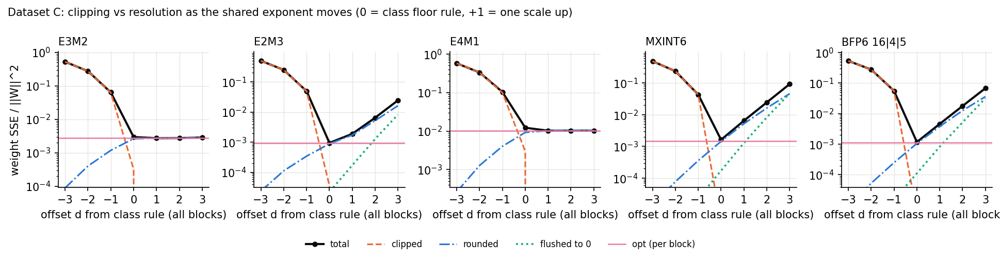

# CS611 Assignment 1, Group 8 (Dataset C, 6-bit)

Picks the best 6-bit format (MXFP6 E3M2 / E2M3 / E4M1, MXINT6, BFP6) for W_C,
using a histogram-based predictor instead of brute-force quantization.

## Requirements
Python 3.8+ and numpy (`pip install numpy`). Nothing else.

## Data
Put `W_C.npy` and `X_cal.npy` in `data/` (already included), or pass
`--data <folder>` to any script.

## Run
    python3 test_formats.py         # unit tests for the quantizers (17 tests)
    python3 run_baseline.py         # exhaustive baseline -> results/baseline_C.csv/.json
    python3 validate_predictor.py   # main result: predictor vs brute force, accuracy and cost
    python3 explore.py              # brute-force table, scale search, X_cal split, sensitivity
    python3 make_figures.py         # report figures into figures/ (needs: pip install matplotlib)

## Files
- `formats.py`: the five quantizers (+ 2 variants), scale policies ocp/ceil/opt, metrics, exhaustive harness (API: `FORMATS_API.md`)
- `test_formats.py`: unit tests; `run_baseline.py`: exhaustive ground truth for the selector
- `predictor.py`: the format-selection algorithm (histogram + XX^T metric)
- `validate_predictor.py`: checks the predictor on W_C and 90 synthetic matrices
- `explore.py`: exhaustive baseline and the outlier / sparsity / scale experiments
- `make_figures.py`: generates the four report figures
- `report/`: draft report (`report_draft.docx`) and its builder script
- `data.py`: data loading; `scipy_free_stats.py`: rank-correlation helper

Format conventions are provisional (OCP MX v1.0; E4M1 and BFP6 assumed). See the
docstring at the top of `formats.py`.

## Use the predictor on your own matrices
    from predictor import select
    best, scores = select(W, X)

## Scale-optimization study (Anuj Chaudhary)

How much does the choice of the shared exponent matter, and does it change which format wins?

### Run
    python3 test_scale_opt.py       # 12 tests, including the two hand examples below
    python3 scale_study.py          # cross-check + all tables -> results/scale_study.md, results/scale_study_C.csv,
                                    # figure -> figures/fig5_scale_tradeoff.png  (about 15 s)
    python3 scale_study.py --data <folder>   # every W_<tag>.npy in the folder (with X_cal.npy), e.g. datasets A-E

### Files
- `scale_opt.py`: independent implementation of the shared-exponent policies. It does not import `formats.py`, and it uses a different method on purpose (grid lookup for rounding, `frexp` for floor(log2), `ceil` derived as e_ocp or e_ocp + 1), so it can cross-check `formats.py`. It includes D1 BFP6 (16|4|5, 4-bit exponent clamped to [-8, 7]) and the E4M1 one-NaN variant.
- `test_scale_opt.py`: unit tests (grids, RNE ties, -0, exact floor(log2), clamps, tail block, policy properties, hand examples).
- `scale_study.py`: the study; every number below comes from `results/scale_study.md`.

### Policies compared
| policy | what it does | roundings per weight |
|---|---|---|
| `ocp` | class floor rule, e = floor(log2 max) - emax | 1 |
| `ceil` | smallest power-of-two scale that clips nothing | 1 |
| `opt` | per block try e_ocp + {-2, -1, 0, +1}, keep lowest weight SSE | 4 |
| `opt_wide` / `oracle_w` | same with -3..+2 / -8..+8 | 6 / 17 |
| `model` | same window, error predicted without rounding (exact clip/flush, step^2/12 otherwise) | 0 |
| `opt_out` | window -2..+1, output-aware r^T H_bb r, H from the even (fit) columns | 4 |
| `oracle_y` | all exponents of a row chosen jointly for r^T H r with the full H, fit columns | 6 |
| `bound_y` | as `oracle_y` but fitted on the held-out columns: a bound, not a usable policy | 6 |

### Results on dataset C (relative error of Y = W X on the held-out odd columns, %)
| format | bits/elem | ocp (class) | ceil | **opt** | model | opt_out | oracle_y | bound_y |
|---|---|---|---|---|---|---|---|---|
| **E2M3** | 6.32 | **3.101** | **3.130** | **3.076** | **3.082** | **3.080** | **3.118** | **3.064** |
| BFP6 16\|4\|5 | 6.28 | 3.484 | 3.595 | 3.437 | 3.432 | 3.436 | 3.516 | 3.389 |
| MXINT6 | 6.32 | 4.054 | 4.174 | 3.938 | 3.948 | 3.938 | 3.946 | 3.892 |
| E3M2 | 6.32 | 5.469 | 5.257 | 5.257 | 5.257 | 5.258 | 5.266 | 5.228 |
| E4M1 | 6.32 | 11.149 | 10.237 | 10.237 | 10.237 | 10.229 | 10.231 | 10.197 |

On all 256 columns the class-rule / opt numbers reproduce the team table (E2M3 3.079 / 3.058, MXINT6 4.047 / 3.896, E3M2 5.439 / 5.236, E4M1 11.088 / 10.176); D1 BFP6 under the class rule is 3.464.

- **Gain of `opt` over the class rule (held-out):** E3M2 3.9%, E2M3 0.8%, E4M1 8.2%, MXINT6 2.9%, BFP6 1.3%. In % points with paired-bootstrap 95% intervals over the held-out columns: E2M3 +0.024 [+0.014, +0.035], MXINT6 +0.116 [+0.074, +0.154], BFP6 +0.046 [+0.019, +0.073], E3M2 +0.212 [+0.176, +0.248], E4M1 +0.911 [+0.802, +1.022]. All exclude 0.
- **The ranking never changes:** E2M3 < BFP6 < MXINT6 < E3M2 < E4M1 under all nine policies; the gap between the winner and the runner-up has a 95% interval excluding 0 every time (`opt`: 0.361 [0.304, 0.413]).
- **A wider window does not help:** `opt_wide` and `oracle_w` (-8..+8) pick exactly the same exponents as `opt`. The searches only use d in {0, +1} for the FP formats and d in {-1, 0, +1} for MXINT6/BFP6; d = -2 is never chosen.
- **The output-aware objective does not help:** `opt_out` is within 0.01 % points of `opt` for every format. The joint `oracle_y` is best on the columns it was fitted on but worse on the held-out ones (E2M3: 3.024 fit / 3.118 held-out vs `opt` 3.040 / 3.076): it overfits the noisy off-diagonal terms of X_fit X_fit^T (128 columns for 100 inputs). X_cal is nearly white, so weight error is the right objective.
- **Little headroom left:** even `bound_y`, fitted on the held-out columns themselves, only reaches 3.064 for E2M3 vs 3.076 for `opt`.
- **The no-rounding `model` picks the same exponent as `opt` in 92.0-98.8% of blocks** and is within 0.01 % points of it held-out, so `opt` can be predicted without rounding anything.

### Why: clipping versus resolution
Block max a, E = floor(log2 a), mantissa of the max m = a / 2^E in [1, 2). The class rule puts the max at m * 2^emax on the element grid; the largest element is vmax = r * 2^emax.

1. **The floor rule clips when m > r**, and r < 2 for every candidate: E2M3 1.875, E3M2 1.75, E4M1 1.5 (r = 2 - 2^-mb, all mantissa codes of the top binade are finite), MXINT6/BFP6 31/16 = 1.9375. The clip error is (m - r) * 2^E < 2^(E - mb): up to one full step, twice the worst rounding error.
2. **How often:** if log2 a is spread evenly within a binade, P(m > r) = log2(2/r). Predicted vs observed share of clipped blocks on W_C: E4M1 41.5% / 40.0%, E3M2 19.3% / 19.5%, E2M3 9.3% / 10.0%, MXINT6 4.6% / 4.8%, BFP6 4.6% / 4.4%. The E4M1 one-NaN variant (vmax 256) has r = 1, so nearly every block clips: 20.662% held-out under the class rule vs 11.149% for vmax 384.
3. **What one exponent up costs:** an FP weight in the normal range has absolute step 2^(floor(log2|w|) - mb), independent of the scale, so only weights that drop into the subnormal range get coarser. The normal range spans 3 binades for E2M3, 7 for E3M2, 15 for E4M1. For INT/BFP the step is scale/16, so every weight gets coarser. Share of the other weights in clipped blocks whose step doubles: E4M1 0.0%, E3M2 7.1%, E2M3 61.6%, MXINT6 100%, BFP6 100%.

   | clipped blocks only | clip SSE at e_ocp | same weights at e_ocp+1 | other weights' change | net from going up |
   |---|---|---|---|---|
   | E3M2 | 3.1716 | 0.9037 | +0.0012 | -2.2667 (helps) |
   | E4M1 | 29.8633 | 9.9800 | +0.0000 | -19.8833 (helps) |
   | E2M3 | 0.3626 | 0.1140 | +0.3597 | +0.1112 (hurts) |
   | MXINT6 | 0.0402 | 0.0607 | +0.8836 | +0.9041 (hurts) |
   | BFP6 16\|4\|5 | 0.0549 | 0.0909 | +0.6680 | +0.7040 (hurts) |

   This is why `ceil` helps E3M2/E4M1 and hurts E2M3/MXINT6/BFP6. It also explains why E4M1 with vmax 384, 192 or 256 gives identical results under `ceil` (10.237%): when nothing clips and nothing is subnormal, the FP scale choice is irrelevant.
4. **The integer formats prefer a smaller scale (d = -1):** every step halves but the clip level drops to (31/32) * 2^E. With one weight above it and uniform rounding noise, d = -1 wins when (m - 31/32)^2 < 2^-8 ((N - 1)/16 + 1/12), N = block size, i.e. m < m*. MXINT6: m* = 1.058, predicted 32 blocks, observed 27. BFP6: m* = 1.032, predicted 32, observed 31. For FP formats d = -1 buys nothing for normal weights, so it is never chosen.

### Hand examples (checked by `test_scale_opt.py`)
- **MXINT6**, x = [4.05, 0.3, -0.6, 0.2, 0.9, -0.1, 0.45, 1.1], class exponent e = 2. SSE at e = 1 / 2 / 3: **0.040625** / 0.050 / 0.125. At e = 1 the outlier is clipped to 3.875, but the other seven weights get half the step (their SSE falls from 0.0475 to 0.0100), so `opt` picks e = 1.
- **E2M3**, x = [3.9, 0.3, -0.2, 0.1, 1.3, -0.7, 0.45, 2.2], class exponent e = -1 clips 3.9 to 3.75. SSE at e = -1 / 0: 0.028750 / **0.025625**. The normal weights 1.3 and 2.2 quantize identically at both exponents; only the weights that become subnormal (0.3, -0.2, -0.7, 0.45) get coarser.

### Cross-check of `formats.py`
0 differing elements across 7 matrices (W_C, Gaussian, Laplace, Student-t, 70% sparse, rows scaled 1e+-6, FP32 maxima at and just below powers of two) for E3M2, E2M3, E4M1, MXINT6, E4M1_v192 and the current BFP6, under ocp, ceil, opt, opt with H and the +-3 search. D1 BFP6 matches `formats.py`'s MXINT6 with block=16 bit-for-bit where the 4-bit clamp cannot bind. Edge case: `np.floor(np.log2(a))` rounds up for a float64 a few ulps below a power of two (a = 7.999999999999999 gives E2M3 exponent 1 instead of 0); it cannot happen for FP32 data (0 of 253 powers of two), so no result changes; `np.frexp(a)[1] - 1` is exact.

### Limitations
- Only dataset C so far; A-E need the course data (`--data`).
- The bootstrap resamples X columns with W fixed: it shows stability to the choice of input columns, not to a different W.
- `model` and the m* rule assume uniform rounding noise (step^2/12).
- The output-aware conclusions rely on X_cal being nearly white; a strongly correlated X_test could change them.
- `oracle_y` uses coordinate descent: checked against full enumeration for the four MX formats (identical for E3M2, E4M1, MXINT6; E2M3 differs in 2/100 rows, objective gap 0.0234%); not enumerated for BFP6.
- The BFP6 4-bit exponent clamp never binds on C, so it is exercised only by unit tests.
